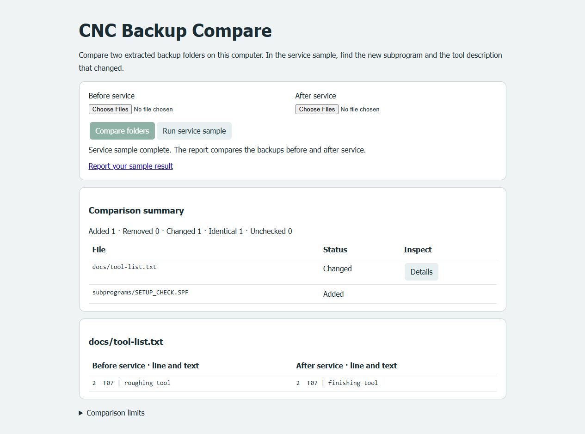

# CNC Backup Compare

[Try the sample and report your result](https://github.com/aminenayatollahi-source/cnc-backup-compare/issues/1)

[Open the browser demo](https://aminenayatollahi-source.github.io/cnc-backup-compare/)

Compare two extracted CNC backup folders before and after a service visit. It runs in your browser and reads the folders you select locally.

## Try the service-visit sample

A technician saved a second backup after a service visit. Which subprogram appeared, and which tool description changed? [Open the demo](https://aminenayatollahi-source.github.io/cnc-backup-compare/), click **Run service sample**, then use **Details** on the changed file. Both snapshots are built in.

Check your findings and see the comparison

The report shows one added file, one changed file and one identical file. The new `subprograms/SETUP_CHECK.SPF` is a comment-only training placeholder. In `docs/tool-list.txt`, line 2 changes from `T07 | roughing tool` to `T07 | finishing tool`. The tool list documents a description; it contains no tool offsets.

[Share your findings](https://github.com/aminenayatollahi-source/cnc-backup-compare/issues/1) with your browser name and the two changes you found.

## Compare your folders

1. Choose the older extracted folder under **Before service** and the newer one under **After service**.
2. Click **Compare folders**. Files are matched by their relative paths within the two selected roots.
3. Use **Details** to inspect changed files. Matching paths are compared with SHA-256. Supported text files show the old and new line numbers side by side.

The application is a single [HTML file](index.html) with embedded JavaScript and CSS. It uses the browser's directory picker and Web Crypto. You can download the file for local use. The hosted demo processes the file contents in the browser as well.

## Limits

- Extract archives first. The tool compares file contents and does not decode proprietary CNC archive or PLC formats.
- The per-file hashing limit is 64 MiB. Unreadable and oversized matching files have a separate unchecked status.
- Line comparison supports UTF-8 and BOM-marked UTF-16, up to 128 KiB per file and 750,000 comparison cells. Binary differences are reported by hash.
- The example and validation use synthetic backups. For a bug report, include the browser version and a small synthetic example you can share publicly.

[Report an issue](https://github.com/aminenayatollahi-source/cnc-backup-compare/issues) · [MIT License](LICENSE)
